# 📐 System Architecture Specifications & UML Diagrams (AAS + Unity + Digital Twin)

This document contains the complete technical specification for all system modules, standard AAS JSON Submodel Schemas, and **5 UML Diagrams** in Mermaid format, ready for copying into **Draw.io** or rendering directly in Markdown/LaTeX thesis documents.

> 💡 **How to import into Draw.io**:
> 1. Open [Draw.io](https://app.diagrams.net).
> 2. Navigate to: **Arrange** $\rightarrow$ **Insert** $\rightarrow$ **Advanced** $\rightarrow$ **Mermaid**.
> 3. Paste the code for any diagram below and click **Insert**.

---

## 1. System Architecture Overview (Component Diagram)

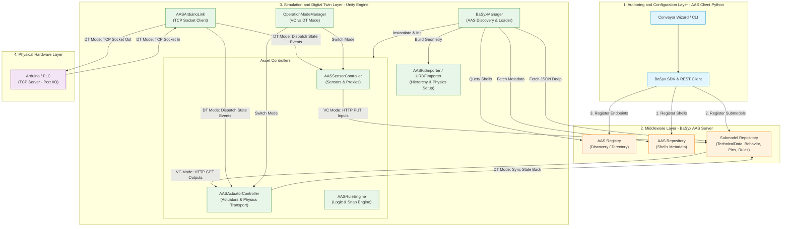

---

## 2. Expanded AAS Creation & Publishing Pipeline (Python $\rightarrow$ BaSyx)

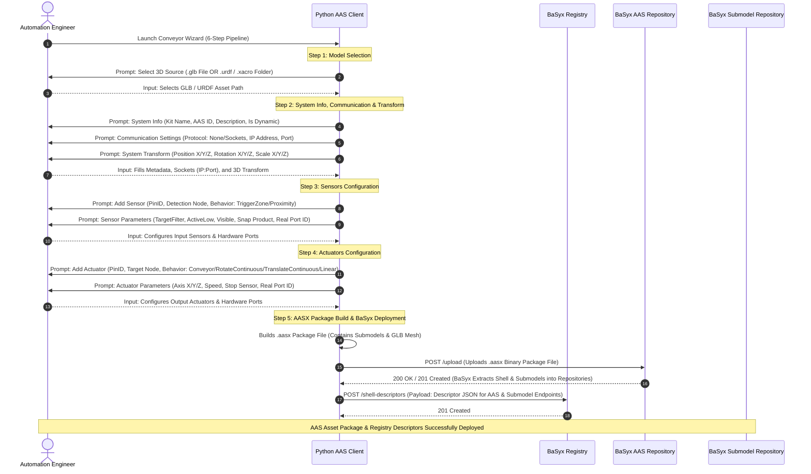


### Step 1 · Model Selection

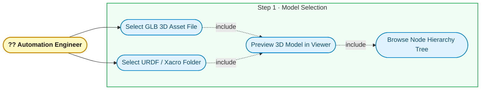

---

### Step 2 · System Info, Communication & Transform

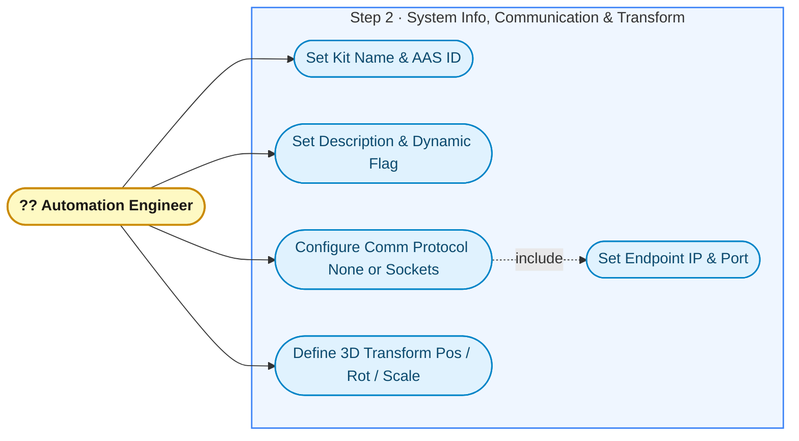

---

### Step 3 · Sensors Configuration (Inputs)

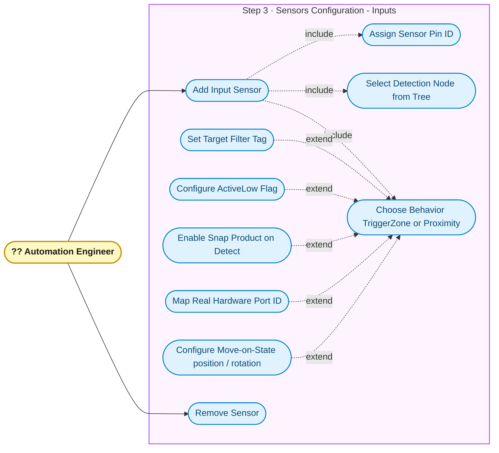

---

### Step 4 · Actuators Configuration (Outputs)

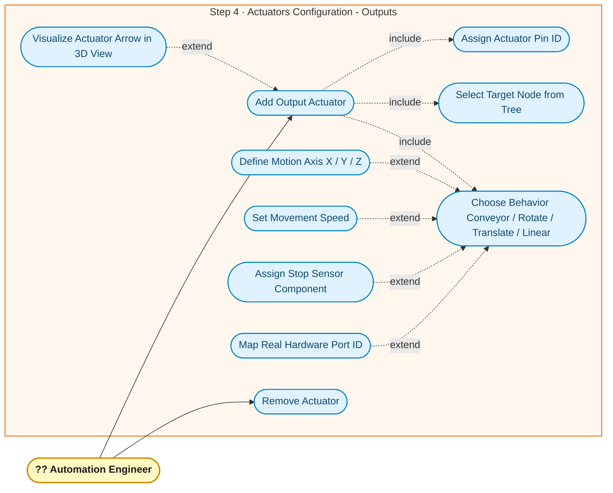

---

### Step 5 · Review, Build & Deploy

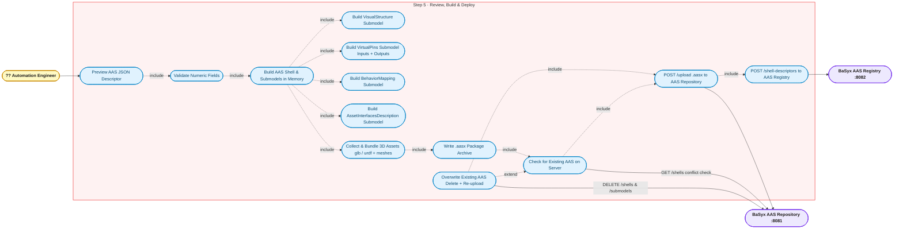

---

### Operações Auxiliares

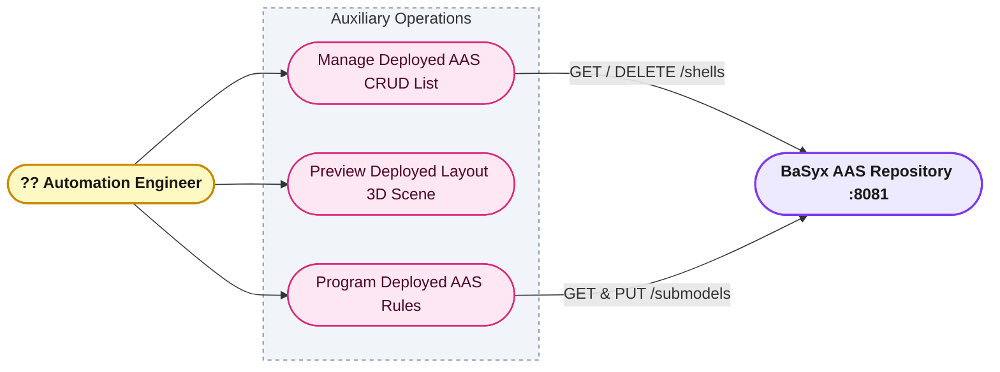
---

## 3. Discovery, Parsing & Dynamic Instantiation in Unity

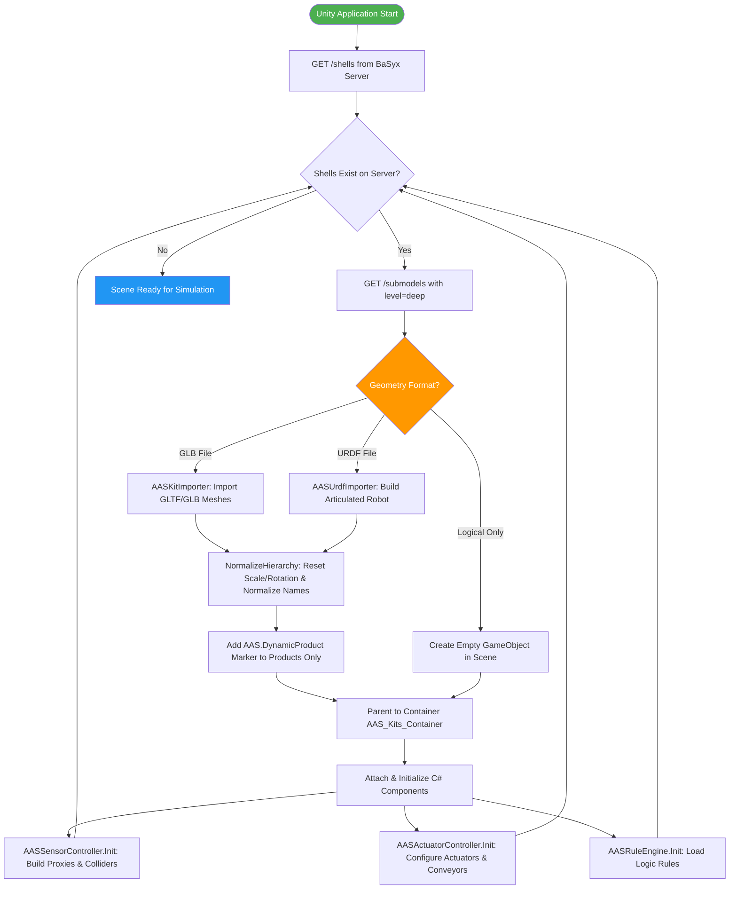

---

## 4. Runtime Execution: Virtual Commissioning vs Digital Twin

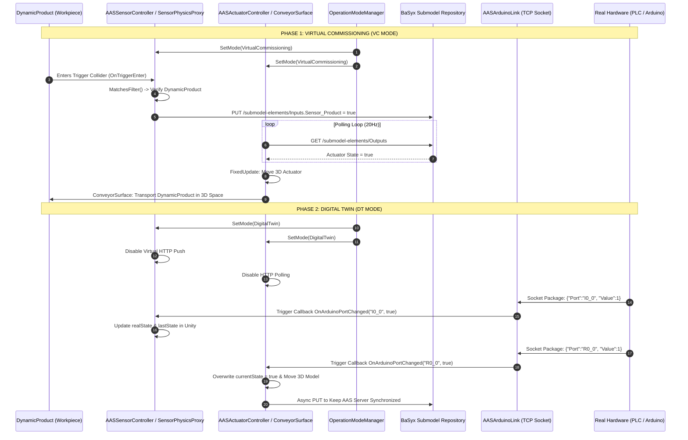

---

## 5. Complete C# Framework UML Class Diagram

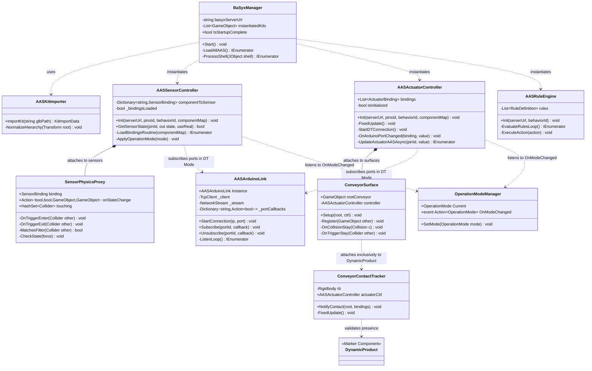

---

# 🗂️ AAS JSON Submodeling Specification & Deep-Dive

This section details the JSON metamodel hierarchy used to serialize industrial asset definitions into the BaSyx AAS Repository.

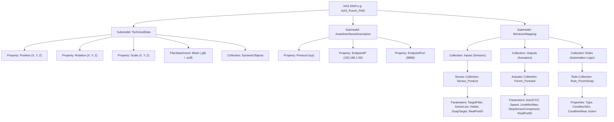

---

## 📄 Submodel Schemas & JSON Examples

### 1. `TechnicalData` (Visual & Spatial Submodel)
Stores 3D model reference URLs, spatial coordinates, scale factors, and product identification lists.

```json
{
  "idShort": "TechnicalData",
  "modelType": "Submodel",
  "submodelElements": [
    { "idShort": "PositionX", "modelType": "Property", "valueType": "xs:float", "value": "9.0" },
    { "idShort": "PositionY", "modelType": "Property", "valueType": "xs:float", "value": "0.0" },
    { "idShort": "PositionZ", "modelType": "Property", "valueType": "xs:float", "value": "0.0" },
    { "idShort": "ScaleX", "modelType": "Property", "valueType": "xs:float", "value": "0.5" },
    { "idShort": "ScaleY", "modelType": "Property", "valueType": "xs:float", "value": "0.5" },
    { "idShort": "ScaleZ", "modelType": "Property", "valueType": "xs:float", "value": "0.5" },
    { "idShort": "Mesh", "modelType": "File", "contentType": "model/gltf-binary", "value": "Punch_FMS.glb" },
    {
      "idShort": "DynamicObjects",
      "modelType": "SubmodelElementCollection",
      "value": [
        { "idShort": "Obj_0", "modelType": "Property", "valueType": "xs:string", "value": "Product_Cube" }
      ]
    }
  ]
}
```

---

### 2. `AssetInterfacesDescription` (Hardware Communication Submodel)
Defines the physical socket communication interface parameters required for Digital Twin synchronization.

```json
{
  "idShort": "AssetInterfacesDescription",
  "modelType": "Submodel",
  "submodelElements": [
    { "idShort": "Protocol", "modelType": "Property", "valueType": "xs:string", "value": "tcp" },
    { "idShort": "EndpointIP", "modelType": "Property", "valueType": "xs:string", "value": "192.168.1.50" },
    { "idShort": "EndpointPort", "modelType": "Property", "valueType": "xs:integer", "value": "8888" }
  ]
}
```

---

### 3. `BehaviorMapping` (Sensors, Actuators & Rules Submodel)
Configures simulation proxies, physical I/O ports, collision filters, and logic rules.

```json
{
  "idShort": "BehaviorMapping",
  "modelType": "Submodel",
  "submodelElements": [
    {
      "idShort": "Inputs",
      "modelType": "SubmodelElementCollection",
      "value": [
        {
          "idShort": "Sensor_Product",
          "modelType": "SubmodelElementCollection",
          "value": [
            { "idShort": "PinID", "modelType": "Property", "valueType": "xs:string", "value": "Sensor_Product" },
            { "idShort": "Component", "modelType": "Property", "valueType": "xs:string", "value": "TriggerZone" },
            { "idShort": "Type", "modelType": "Property", "valueType": "xs:string", "value": "TriggerZone" },
            {
              "idShort": "Parameters",
              "modelType": "SubmodelElementCollection",
              "value": [
                { "idShort": "TargetFilter", "modelType": "Property", "valueType": "xs:string", "value": "Metal" },
                { "idShort": "ActiveLow", "modelType": "Property", "valueType": "xs:boolean", "value": "false" },
                { "idShort": "Visible", "modelType": "Property", "valueType": "xs:boolean", "value": "false" },
                { "idShort": "RealSensorEnabled", "modelType": "Property", "valueType": "xs:boolean", "value": "true" },
                { "idShort": "RealPortID", "modelType": "Property", "valueType": "xs:string", "value": "I0_0" }
              ]
            }
          ]
        }
      ]
    },
    {
      "idShort": "Outputs",
      "modelType": "SubmodelElementCollection",
      "value": [
        {
          "idShort": "Punch_Forward",
          "modelType": "SubmodelElementCollection",
          "value": [
            { "idShort": "PinID", "modelType": "Property", "valueType": "xs:string", "value": "Punch_Forward" },
            { "idShort": "Component", "modelType": "Property", "valueType": "xs:string", "value": "Torre Horizontal" },
            { "idShort": "Type", "modelType": "Property", "valueType": "xs:string", "value": "TranslateContinuous" },
            {
              "idShort": "Parameters",
              "modelType": "SubmodelElementCollection",
              "value": [
                { "idShort": "AxisX", "modelType": "Property", "valueType": "xs:float", "value": "1.0" },
                { "idShort": "AxisY", "modelType": "Property", "valueType": "xs:float", "value": "0.0" },
                { "idShort": "AxisZ", "modelType": "Property", "valueType": "xs:float", "value": "0.0" },
                { "idShort": "Speed", "modelType": "Property", "valueType": "xs:float", "value": "1.0" },
                { "idShort": "StopSensorComponent", "modelType": "Property", "valueType": "xs:string", "value": "Sensor_Forward" },
                { "idShort": "RealActuatorEnabled", "modelType": "Property", "valueType": "xs:string", "value": "true" },
                { "idShort": "RealPortID", "modelType": "Property", "valueType": "xs:string", "value": "R0_0" }
              ]
            }
          ]
        }
      ]
    },
    {
      "idShort": "Rules",
      "modelType": "SubmodelElementCollection",
      "value": [
        {
          "idShort": "Rule_SnapOnProductArrival",
          "modelType": "SubmodelElementCollection",
          "value": [
            { "idShort": "Type", "modelType": "Property", "valueType": "xs:string", "value": "if" },
            { "idShort": "ConditionSim", "modelType": "Property", "valueType": "xs:string", "value": "Inputs.Sensor_Product" },
            { "idShort": "ConditionReal", "modelType": "Property", "valueType": "xs:string", "value": "Inputs.Sensor_Product" },
            {
              "idShort": "Action",
              "modelType": "SubmodelElementCollection",
              "value": [
                { "idShort": "ActionType", "modelType": "Property", "valueType": "xs:string", "value": "snap" },
                { "idShort": "Target", "modelType": "Property", "valueType": "xs:string", "value": "TriggerZone" }
              ]
            }
          ]
        }
      ]
    }
  ]
}
```

---

# 📖 Module Technical Specifications

### Module 1: Python AAS Client & Authoring (`AAS Client` / `conveyor_wizard.py`)
* **Role**: Models asset submodels (`TechnicalData`, `AssetInterfacesDescription`, `BehaviorMapping`) and packages them into a binary `.aasx` archive (including the `.glb` mesh file). Deploys to BaSyx via two HTTP calls: `POST /upload` (multipart binary upload of the `.aasx` package to the AAS+Submodel Repositories) and `POST /shell-descriptors` (registers the AAS endpoint descriptor in the BaSyx Registry).

### Module 2: BaSyx Middleware Server
* **Role**: Serves as the central AAS Server (Single Source of Truth), decoupling configuration from Unity execution. Comprises the **AAS Registry**, **AAS Repository**, and **Submodel Repository**.

### Module 3: Unity Discovery & Loading (`BaSyxManager` & Importers)
* **Role**: Dynamically queries the BaSyx server at startup (`GET /shells`), imports 3D geometry (`.glb` / `.urdf`), bakes transform scaling, and injects the `DynamicProduct` marker component onto dynamic workpieces.

### Module 4: Sensor Management (`AASSensorController` & `SensorPhysicsProxy`)
* **Role**: Creates kinematic trigger colliders. `MatchesFilter` requires `DynamicProduct` when filtering for `"Metal"` (ensuring actuators like punches do not trigger product sensors). In VC mode, updates AAS via HTTP `PUT`. In DT mode, listens to hardware TCP socket events.

### Module 5: Actuator Control & Physics Transport (`AASActuatorController`)
* **Role**: Translates AAS output states into 3D movements (`TranslateContinuous`, `RotateContinuous`, `TranslateFixed`, `RotateHinge`). `ConveyorSurface` + `ConveyorContactTracker` transports dynamic workpieces without parent-child coupling, strictly ignoring static structural parts and sensors.

### Module 6: Logic Engine (`AASRuleEngine`)
* **Role**: Evaluates JSON logic rules (`if`, `if_else`) in a 10Hz coroutine loop, executing actions such as product snapping or visibility toggling.

### Module 7: Hardware Communication (`AASArduinoLink`)
* **Role**: A singleton C# TCP Socket client maintaining bi-directional socket connections to physical PLCs/Arduinos and dispatching port events (`I0_0`, `R0_0`) to Unity controllers.
