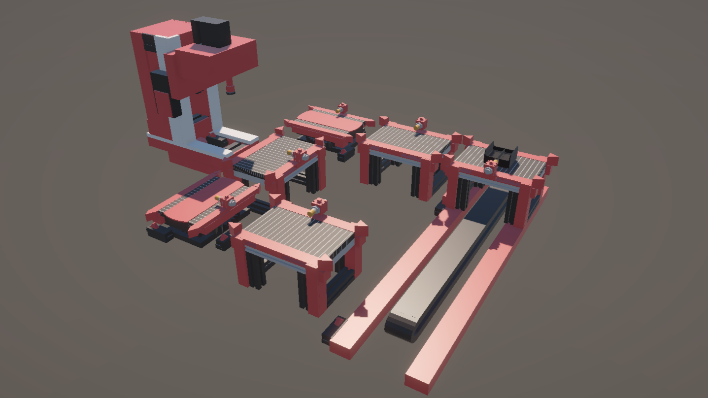
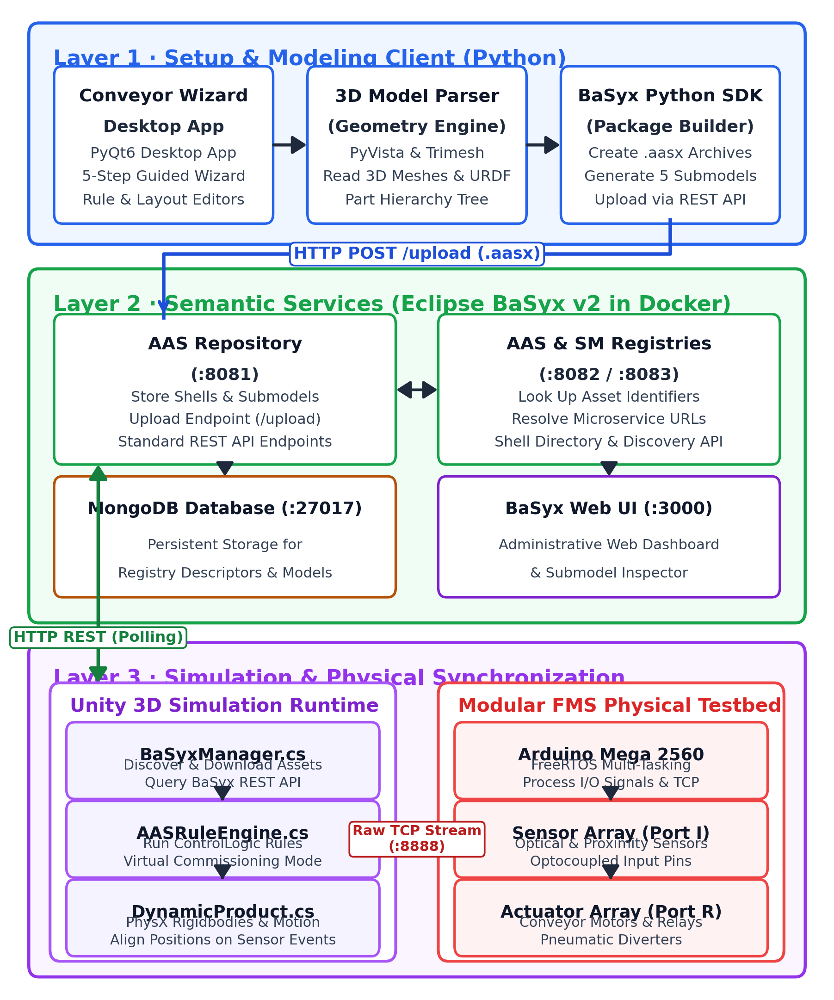
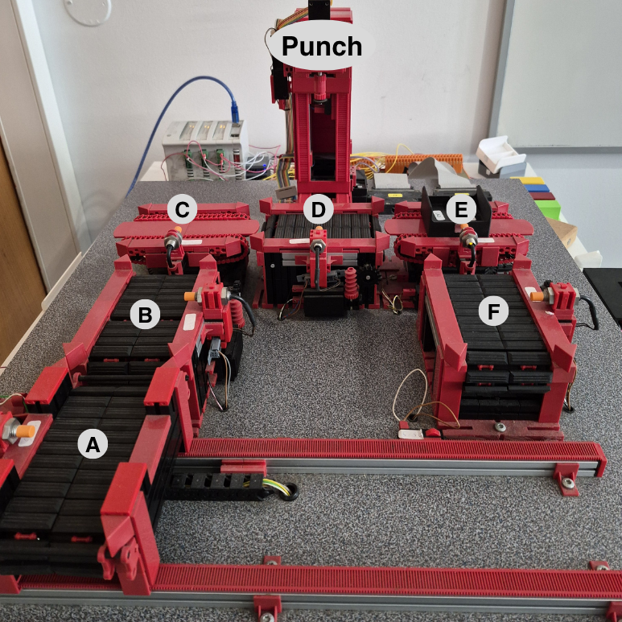

<div align="center"> 

# Automatic Generation of Simulation-Based Digital Twins from Asset Administration Shells
[](https://opensource.org/licenses/MIT)
[](https://run.unl.pt)
[](https://run.unl.pt)

[Tiago Gouveia](https://pt.linkedin.com/)<sup>1</sup>, 
[André Dionisio Rocha](https://scholar.google.pt/citations?user=k1GIyqcAAAAJ&hl=pt-PT)<sup>1</sup>,
[Nelson Freitas](https://scholar.google.com/)<sup>1</sup>

<sup>1</sup> **NOVA School of Science and Technology, Center of Technology and Systems (UNINOVA-CTS)**,
and Associated Lab of Intelligent Systems (LASI), NOVA University Lisbon, 2829-516 Caparica, Portugal

<table>
  <tr>
    <td style="vertical-align: top;">
      The Industry 4.0 paradigm relies on Cyber-Physical Systems (CPS) to achieve agile and resilient production. Digital Twins (DT) provide virtual representations capable of mirroring physical assets through real-time bidirectional telemetry. However, traditional development relies on proprietary simulation software, fragmented 3D CAD files lacking kinematics, and tedious manual matching of I/O addresses.<br/><br/>
      To overcome these barriers, this repository presents an open, modular, model-driven framework for automated procedural generation and live synchronization of industrial Digital Twins from Asset Administration Shells (AAS).
    </td>
    <td style="vertical-align: top;">
      
    </td>
  </tr>
</table>

</div>

---

## <div align="center">Framework Architecture</div>

The architecture spans four decoupled tiers, bridging low-polygon geometric asset modeling to live physical shop-floor synchronization:

<p align="center">
  
</p>

1. **Layer 0 - Physical Asset Digitization (Blender):** Modeling lightweight 3D assets with proper origin points, metric scale, and kinematic hierarchy.
2. **Layer 1 - No-Code Semantic Authoring (AAS Client / Python):** Studio GUI (`conveyor_wizard.py`) for 3D raycasting asset placement, I/O pin mapping, visual control logic authoring, and packaging into standardized `.aasx` containers.
3. **Layer 2 - Containerized AAS Storage & Discovery (Docker & BaSyx v2):** Eclipse BaSyx microservices hosting Submodel Registries, AAS Servers, MQTT Broker (Mosquitto), and Time-Series DB (InfluxDB).
4. **Layer 3 - Procedural Simulation & Live Sync (Unity 3D Engine):** Procedural scene assembly from BaSyx AAS models, physics-based kinematic simulation, dual-mode execution (Virtual Commissioning / Live Telemetry Sync), and sensor drift correction.
5. **Physical Hardware & Firmware (M-DUINO PLC):** Industrial Shields PLC running FreeRTOS for low-latency 5 ms input scanning, optocoupled galvanic isolation, dual-channel TCP telemetry socket, and HTTP actuation.

---

## <div align="center">Repository Structure</div>

```
AAS-DT-Framework/
├── Layer 0 - 3D Models/      # Layer 0: Low-polygon 3D CAD assets (GLB) for authoring new AAS units
│   ├── Conveyor_Belt.glb     # Linear conveyor module
│   ├── Conveyor_Horizontal.glb # Translating conveyor diverter module
│   ├── Conveyor_Rotary.glb   # Rotating conveyor turntable module
│   ├── Punch_Station.glb     # Workpiece punch / machining station
│   ├── Workpiece.glb         # Dynamic industrial workpiece / puck
│   └── README.md             # Technical catalog & modeling conventions
├── Layer 1 - AAS Client/     # Layer 1: Python AAS Authoring Studio
│   ├── conveyor_wizard.py    # Main GUI Studio for AAS layout generation & submodel creation
│   ├── Backup_models/        # Complete pre-configured AAS backups for the modular FMS pilot testbed
│   └── requirements.txt      # Python dependencies for the authoring studio
├── Layer 2 - AAS Docker/     # Layer 2: Docker Compose infrastructure
│   ├── docker-compose.yml    # Eclipse BaSyx v2 (AAS Registry, Submodel Registry, AAS Server), Mosquitto MQTT & InfluxDB
│   ├── basyx/                # BaSyx configuration properties & YAMLs
│   ├── mosquitto/            # MQTT broker configuration
│   └── influxdb/             # InfluxDB database configuration
├── Layer 3 - DT Unity/       # Layer 3: Unity 3D Simulation & Telemetry Engine
│   ├── Assets/               # C# scripts, prefabs, materials, and AAS procedural generation logic
│   ├── Packages/             # Unity project dependency manifests
│   └── ProjectSettings/      # Unity project physics, tag, and layer settings
├── Hardware - FMS DT/        # Hardware Firmware
│   └── FMS_DT.ino            # FreeRTOS C++ code for Industrial Shields M-DUINO PLC control & TCP/HTTP telemetry
└── imgs/                     # Visual assets, architecture diagrams, and runtime screenshots
```

---

## <div align="center">Get Started</div>

Follow these steps to launch the entire middleware stack, author/restore asset packages, and run the procedural Digital Twin:

### 1. Launch the AAS Containerized Middleware (Layer 2)
Ensure Docker Desktop is running, then start the BaSyx v2 microservices:
```bash
cd "Layer 2 - AAS Docker"
docker-compose up -d
```
This starts the AAS Registry, Submodel Registry, AAS Environment Server, Mosquitto MQTT Broker, and InfluxDB telemetry store.

### 2. Run the AAS Authoring Studio & Deploy Digital Twin (Layer 1)
Install dependencies and launch the Python GUI to author new AAS packages or deploy the benchmark FMS testbed:
```bash
cd "../Layer 1 - AAS Client"
pip install -r requirements.txt
python conveyor_wizard.py
```

> **Quick Start (Deploy Benchmark FMS Digital Twin):**
> 1. In the Conveyor Wizard GUI, click **"Restore AAS"** in the top-right toolbar.
> 2. Select all `.json` files inside the `Backup_models/` folder.
> 3. Click **Yes** when prompted to deploy them directly to the BaSyx server.
> 4. All conveyor modules (`Conveyor_A` through `Conveyor_F`), the punch station (`Punch_FMS`), workpiece (`Product1`), and coordination logic (`FMS`) will be registered and populated in BaSyx.

### 3. Open the Simulation Engine (Layer 3)
1. Launch **Unity 6 (6000.3.10f1)** (or compatible version).
2. Open the project folder `Layer 3 - DT Unity`.
3. Open the main scene in `Assets/Scenes/SampleScene.unity`.
4. Press **Play** to trigger procedural scene assembly automatically fetched from the running BaSyx AAS Server.

### 4. Physical Bench Controller (Optional Hardware Setup)
Flash `Hardware - FMS DT/FMS_DT.ino` onto your **Industrial Shields M-DUINO 57R+ PLC** (powered by Arduino Mega 2560 & W5500 Ethernet) running FreeRTOS. The controller streams real-time sensor events via low-latency **TCP sockets** (port 8888) and accepts actuation commands via **HTTP REST** (port 80) to sync the Unity Digital Twin with physical hardware.

---

## <div align="center">Usage Instructions & Physical Testbed</div>

<p align="center">
  
</p>

Once the containers and simulation runtime are active, the platform supports two operational modes:

- **Virtual Commissioning (VC):** Operates entirely disconnected from physical hardware. Machine actuation, routing sequences, and sensor responses are driven by the local rule engine evaluating the `ControlLogic` submodel abstract syntax trees.
- **Live Telemetry Synchronization:** In operational mode, the Unity runtime establishes a dedicated TCP connection to the M-DUINO PLC (port 8888). Real-time optical and inductive sensor events update the virtual state.
- **Sensor Drift Correction:** When physical workpieces trigger physical track sensors, the simulation automatically snaps the nearest virtual workpiece to calibrated coordinates, eliminating accumulated PhysX numerical drift.

---

## <div align="center">Documentation</div>

Detailed documentation and resource specifications can be found within each layer:

- **[Layer 0 - 3D Models](Layer%200%20-%203D%20Models/):** Geometry guidelines, 1:1 metric scale conventions, pivot alignment standards, and low-polygon GLB asset catalog.
- **[Layer 1 - AAS Client](Layer%201%20-%20AAS%20Client/):** Technical specifications of the PyQt6/PyVista desktop application, 3D raycasting sensor instrumentation, and JSON backup definitions.
- **[Layer 2 - AAS Docker](Layer%202%20-%20AAS%20Docker/):** Microservice port allocation (`8081` Environment, `8082` AAS Registry, `8083` Submodel Registry, `1883` MQTT, `8086` InfluxDB), Docker Compose configuration, and persistent volume paths.
- **[Layer 3 - DT Unity](Layer%203%20-%20DT%20Unity/):** Architecture of procedural scene generation scripts, glTFast asset ingestion, PhysX contact simulation, and TCP socket stream handlers.
- **[Hardware - FMS DT](Hardware%20-%20FMS%20DT/):** FreeRTOS task prioritization, optocoupled I/O mapping, and dual-channel networking (TCP server + HTTP REST).

---

## <div align="center">Key Results & Performance</div>

Empirical evaluation on the physical modular FMS bench and 800 parametric stress-testing runs revealed:
- **Cold-boot instantiation** of the physical pilot bench in under **2.8s**.
- **Steady-state rendering rates** exceeding **480 FPS** for small to medium layouts.
- **Scalability:** Near-linear scaling up to 250 modules and stable real-time execution up to 500 modules (>90 FPS).

---

## <div align="center">Contribution Guidelines</div>

This project is open-source under the MIT license, and contributions from the community and research partners are welcome! For questions, bug reports, and feature requests:
- Open an issue on [GitHub Issues](https://github.com/NOVA-RICS-Open-Lab/AAS-DT-Framework/issues).
- Refer to development workflows within the NOVA RICS Open Lab research collective.

---

## <div align="center">Citation</div>

> ℹ️ **Publication Note:** This Master's dissertation is currently undergoing academic defense and review at NOVA School of Science and Technology (NOVA FCT). The official publication link and permanent handle in the **RUN (Repositório da Universidade NOVA)** repository will be made available here upon public indexing.
>
> In the meantime, if you use or build upon this framework in your research, please cite:

```bibtex
@mastersthesis{gouveia2026digitaltwins,
  author       = {Tiago Daniel Santos Gouveia},
  title        = {Automatic Generation of Simulation-Based Digital Twins from Asset Administration Shells},
  school       = {NOVA School of Science and Technology, NOVA University Lisbon},
  year         = {2026},
  type         = {Master's Thesis},
  note         = {MSc Dissertation (Under Review / Forthcoming in RUN - Repositório da Universidade NOVA)}
}
```

---

## <div align="center">License</div>

This repository is released under the [MIT License](LICENSE).

---

## <div align="center">Contacts</div>

For academic inquiries, collaborations, or questions regarding this framework, please contact:
- **NOVA RICS Open Lab:** [novaricsopenlab@gmail.com](mailto:novaricsopenlab@gmail.com)
- **UNINOVA-CTS / LASI:** NOVA School of Science and Technology, NOVA University Lisbon, Portugal
