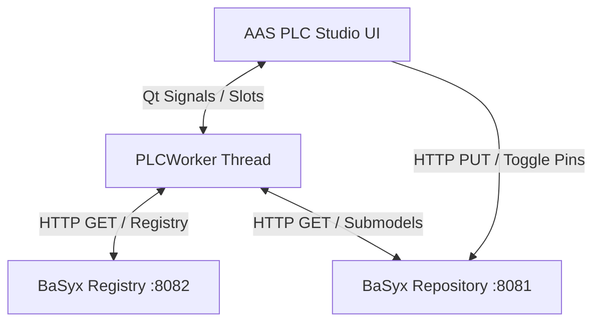

# Design Spec: AAS PLC Studio (PyQt6)
Date: 2026-06-30

## 1. Overview
The **AAS PLC Studio** is a desktop GUI application built in PyQt6 that replaces the terminal-based `conveyor_plc.py`. It provides a visual dashboard to monitor and control virtual inputs (sensors) and outputs (actuators) of Active Asset Administration Shells (AAS) deployed on a BaSyx infrastructure.

## 2. Architecture & Components

### 2.1 UI Component Tree
- `AASPLCStudio` (QMainWindow)
  - `QSplitter` (Main Layout Splitter)
    - `Sidebar` (QWidget)
      - `QLabel` (Registry Status)
      - `QListWidget` (Kits List)
      - `QPushButton` (Scan Registry)
    - `ControlPanel` (QWidget - Selected Kit Panel)
      - `Header` (QHBoxLayout)
        - `QLabel` (Kit Name / ID)
        - `ConnectionLED` (Status Light Indicator)
      - `MainArea` (QHBoxLayout)
        - `InputsGroup` (QGroupBox - Sensors)
          - `QVBoxLayout` containing `PinStatusWidget` (LED, Name, Toggle Switch)
        - `OutputsGroup` (QGroupBox - Actuators)
          - `QVBoxLayout` containing `PinOutputWidget` (Indicator Panel)
    - `LogsViewer` (QTextEdit - Bottom Panel)

### 2.2 Background Polling Thread (`PLCWorker`)
A `QThread` executing a loop:
1. Every 2 seconds: Fetches active shells from the BaSyx Registry at `http://localhost:8082/shell-descriptors`.
2. Every 100ms: If a kit is selected, fetches the `VirtualPins` submodel elements (Inputs and Outputs) from the BaSyx Repository at `http://localhost:8081`.
3. Communicates with the UI thread using custom Qt signals:
   - `kits_discovered = pyqtSignal(list)`
   - `pins_updated = pyqtSignal(list, list)`
   - `connection_status = pyqtSignal(bool)`

## 3. Data Flow
1. **Discovery**:
   - `PLCWorker` queries Registry -> Emits `kits_discovered(list_of_kits)` -> UI populates `QListWidget`.
2. **Monitoring**:
   - User selects a kit -> UI requests `PLCWorker` to poll that kit's `pins_id` -> `PLCWorker` queries Submodel -> Emits `pins_updated(inputs, outputs)` -> UI updates indicator lights (LEDs) and active states.
3. **Simulation/Control**:
   - User toggles a sensor switch -> UI triggers asynchronous HTTP `PUT` request to update the Property under the `Inputs` collection on BaSyx -> BaSyx changes state -> Unity reads state on next poll and acts accordingly.

## 4. UI Esthetics & Styling
- Modern dark theme using stylesheet (dark gray background, rich violet/neon accents).
- LEDs represented as circular CSS-styled QLabel objects:
  - Green LED: `background-color: #2ecc71; border-radius: 6px;`
  - Red/Grey LED: `background-color: #e74c3c; border-radius: 6px;` (or `#7f8c8d` for offline/inactive)
- Smooth grid layouts and clean visual divisions.
