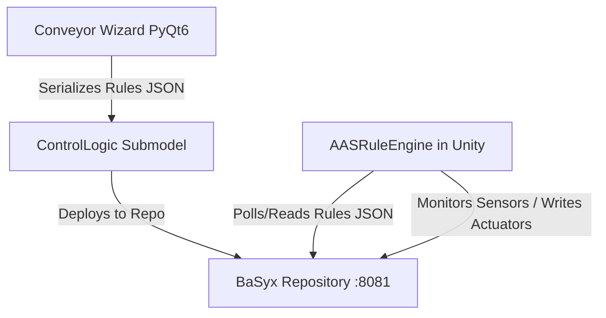

# Design Spec: AAS Control Logic Rules & Sequences
Date: 2026-07-11
Status: Approved

## 1. Overview
This specification details the addition of a **Control Logic** step in the **AAS Conveyor Wizard** (`conveyor_wizard.py`) and a corresponding execution engine in **Unity** (`AASRuleEngine.cs`). It enables users to visually program Arduino-like calibration sequences and triggered step-sequences (stateful actions) using sensors and actuators configured on deployed Asset Administration Shells (AAS). It supports both physical component-bound logic and centralized, purely logical orchestrator shells (which have no 3D model/GLB representation but orchestrate other resources via cross-AAS triggers).

## 2. Architecture & Data Flow



### 2.1 AAS Representation
We introduce a new submodel to the generated AAS package:
- **idShort**: `ControlLogic`
- **id**: `https://acplt.org/Submodels/ControlLogic_<KitName>`
- **Properties**:
  - `Rules` (string, `xs:string`): A single Property containing the serialized JSON string of the rule program.

### 2.2 JSON Rules Schema
The JSON structure supports a setup sequence and multiple event-triggered, conditional sequences, utilizing explicit `"kit"` identifiers on each condition/action to enable cross-AAS orchestration:

```json
{
  "start": [
    {
      "type": "set_actuator",
      "kit": "ConveyorKit",
      "actuator": "Pusher_Pin",
      "value": false
    }
  ],
  "sequences": [
    {
      "name": "Process Product Sequence",
      "trigger": {
        "operator": "AND",
        "conditions": [
          { "kit": "ConveyorKit", "sensor": "Sensor_Entry", "value": true }
        ]
      },
      "steps": [
        {
          "type": "set_actuator",
          "kit": "ConveyorKit",
          "actuator": "Conveyor_Pin",
          "value": true
        },
        {
          "type": "wait_until",
          "operator": "AND",
          "conditions": [
            { "kit": "ConveyorKit", "sensor": "Sensor_Middle", "value": true }
          ]
        },
        {
          "type": "set_actuator",
          "kit": "ConveyorKit",
          "actuator": "Conveyor_Pin",
          "value": false
        },
        {
          "type": "set_actuator",
          "kit": "ConveyorKit",
          "actuator": "Pusher_Pin",
          "value": true
        },
        {
          "type": "wait_until",
          "operator": "AND",
          "conditions": [
            { "kit": "ConveyorKit", "sensor": "Sensor_Limit", "value": true }
          ]
        },
        {
          "type": "set_actuator",
          "kit": "ConveyorKit",
          "actuator": "Pusher_Pin",
          "value": false
        },
        {
          "type": "wait_time",
          "seconds": 2.0
        }
      ]
    }
  ]
}
```

---

## 3. PyQt6 GUI Design (Step 5 & Standalone Dialog)
We integrate the Control Logic step inside `conveyor_wizard.py` and also expose a standalone Rules Editor Dialog that runs without requiring a GLB.

### 3.1 Main Screen Page 1 Button
- Add a new button: `"Program Deployed AAS Rules"`
- On click, displays the list of deployed AAS shells. The user selects one (e.g., `Central_PLC`).
- Opens a standalone dialog `AASRulesEditorDialog` for the selected shell.

### 3.2 Dynamic Cross-AAS Dropdowns
- The rule editor fetches the lists of all sensors and actuators from **all** active AAS shells in the registry.
- Combobox items are formatted as `[KitName] - [PinID]` (e.g. `ConveyorKit - Sensor_Entry`).
- The editor outputs target kit names dynamically into the `"kit"` fields of the JSON.

---

## 4. Unity Rule Engine (`AASRuleEngine.cs` & `IAASDriver`)
A new script in Unity attached to the root of the imported AAS GameObjects, along with an interface abstraction to support multiple communication protocols (Modbus, OPC UA, MQTT) in the future:

### 4.1 Abstraction Interface (`IAASDriver`)
```csharp
public interface IAASDriver
{
    void WriteActuator(string kitId, string pinId, bool value);
    bool ReadSensor(string kitId, string pinId);
}
```
For now, we will implement `AASHttpDriver` which queries `AASSensorController` and sends PUT requests via HTTP. In the future, this can be swapped with other drivers.

### 4.2 Logical Orchestrator Support (No GLB representation)
- In `BaSyxManager.cs`, if a shell has `ControlLogic` but no `VisualStructure` (no GLB), it instantiates a dummy GameObject named `LogicalAAS_<shellIdShort>` and attaches `AASRuleEngine`.
- The rule engine executes logic exactly the same, using `IAASDriver` to resolve remote components.

### 4.3 Execution Logic
1. **Initialize**:
   - Queries the kit's `ControlLogic` submodel to fetch the `Rules` JSON property.
   - Restores/deserializes the JSON structure.
2. **Execute Start**:
   - Runs the `start` list of actions sequentially.
3. **Trigger Evaluation Loop**:
   - Every `0.1s` (or frame), checks all sequences in `sequences`.
   - If a sequence is NOT currently running, and its `trigger` conditions are satisfied, it is marked as running and executes its `steps` in a Unity **Coroutine**.
4. **Step Coroutine Actions**:
   - `set_actuator`: Updates the target actuator pin value using `IAASDriver.WriteActuator`.
   - `wait_time`: `yield return new WaitForSeconds(seconds)`.
   - `wait_until`: Polls sensor states using `IAASDriver.ReadSensor` from the local cache, yielding until the specified boolean conditions (AND/OR) are met.
   - Once all steps complete, marks the sequence as inactive/idle so it can trigger again.

---

## 5. Success Criteria
- [ ] Users can edit and deploy control rules for any active AAS via a standalone dialog, without loading a GLB model.
- [ ] Rule dropdowns allow selecting sensors/actuators from other active AAS shells.
- [ ] Rules are saved under the `ControlLogic` submodel in BaSyx.
- [ ] Unity client runs logic engines on logical-only (no GLB) shells using dummy GameObjects.
- [ ] The `IAASDriver` successfully routes read/write operations to the target kit using the `kit` property.
