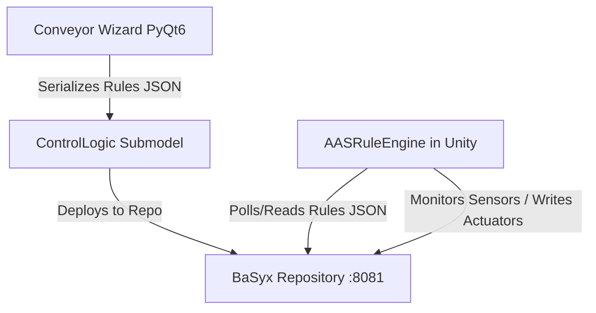

# Design Spec: AAS Control Logic Rules & Sequences
Date: 2026-07-11
Status: Approved

## 1. Overview
This specification details the addition of a **Control Logic** step in the **AAS Conveyor Wizard** (`conveyor_wizard.py`) and a corresponding execution engine in **Unity** (`AASRuleEngine.cs`). It enables users to visually program Arduino-like calibration sequences and triggered step-sequences (stateful actions) using sensors and actuators configured on deployed Asset Administration Shells (AAS).

## 2. Architecture & Data Flow



### 2.1 AAS Representation
We introduce a new submodel to the generated AAS package:
- **idShort**: `ControlLogic`
- **id**: `https://acplt.org/Submodels/ControlLogic_<KitName>`
- **Properties**:
  - `Rules` (string, `xs:string`): A single Property containing the serialized JSON string of the rule program.

### 2.2 JSON Rules Schema
The JSON structure supports a setup sequence and multiple event-triggered, conditional sequences:

```json
{
  "start": [
    {
      "type": "set_actuator",
      "actuator": "Pusher_Pin",
      "value": false
    }
  ],
  "sequences": [
    {
      "name": "Process Product Sequence",
      "trigger": {
        "operator": "AND",
        "conditions": [
          { "sensor": "Sensor_Entry", "value": true }
        ]
      },
      "steps": [
        {
          "type": "set_actuator",
          "actuator": "Conveyor_Pin",
          "value": true
        },
        {
          "type": "wait_until",
          "operator": "AND",
          "conditions": [
            { "sensor": "Sensor_Middle", "value": true }
          ]
        },
        {
          "type": "set_actuator",
          "actuator": "Conveyor_Pin",
          "value": false
        },
        {
          "type": "set_actuator",
          "actuator": "Pusher_Pin",
          "value": true
        },
        {
          "type": "wait_until",
          "operator": "AND",
          "conditions": [
            { "sensor": "Sensor_Limit", "value": true }
          ]
        },
        {
          "type": "set_actuator",
          "actuator": "Pusher_Pin",
          "value": false
        },
        {
          "type": "wait_time",
          "seconds": 2.0
        }
      ]
    }
  ]
}
```

---

## 3. PyQt6 GUI Design (Step 5: Control Logic)
We add a new page `self.page5` inside `conveyor_wizard.py` right before the Preview page (which shifts to Page 6).

### 3.1 Components
- **Sequences List (Left Panel)**: Lists `"Start Sequence"` and any user-defined sequences.
- **Trigger Conditions Editor (Middle Panel)**: Visible only for custom sequences. Allows configuring an operator (`AND` or `OR`) and adding conditions: `[Sensor Combobox] [Value Combobox] [Remove Button]`.
- **Sequence Steps Editor (Right Panel)**: Shows the vertical sequence of steps. Includes buttons:
  - `Add Set Actuator`
  - `Add Wait Until`
  - `Add Wait Time`
  - `Move Up` / `Move Down`
  - `Remove Step`
- **Step Editor Pane (Bottom)**: Adjusts parameters of the currently selected step (e.g., input fields for actuator value, delay timer, or compound sensor conditions).

---

## 4. Unity Rule Engine (`AASRuleEngine.cs`)
A new script in Unity attached to the root of the imported AAS GameObjects:

### 4.1 Execution Logic
1. **Initialize**:
   - Queries the kit's `ControlLogic` submodel to fetch the `Rules` JSON property.
   - Restores/deserializes the JSON structure.
2. **Execute Start**:
   - Runs the `start` list of actions sequentially.
3. **Trigger Evaluation Loop**:
   - Every `0.1s` (or frame), checks all sequences in `sequences`.
   - If a sequence is NOT currently running, and its `trigger` conditions are satisfied, it is marked as running and executes its `steps` in a Unity **Coroutine**.
4. **Step Coroutine Actions**:
   - `set_actuator`: Updates the target actuator pin value on BaSyx (via `PUT` request).
   - `wait_time`: `yield return new WaitForSeconds(seconds)`.
   - `wait_until`: Polls sensor states from the local `AASSensorController` cache, yielding until the specified boolean conditions (AND/OR) are met.
   - Once all steps complete, marks the sequence as inactive/idle so it can trigger again.

---

## 5. Success Criteria
- [ ] Users can define logic rules (Start sequence, and custom triggered sequences) in the Conveyor Wizard.
- [ ] Rules are saved, compiled, and deployed to BaSyx within the `ControlLogic` submodel.
- [ ] Unity client detects the submodel, downloads the JSON, and executes the `start` routine once.
- [ ] Unity client executes `sequences` whenever trigger conditions are met.
- [ ] Actuators and sensors react exactly as defined in the programmed sequences.
